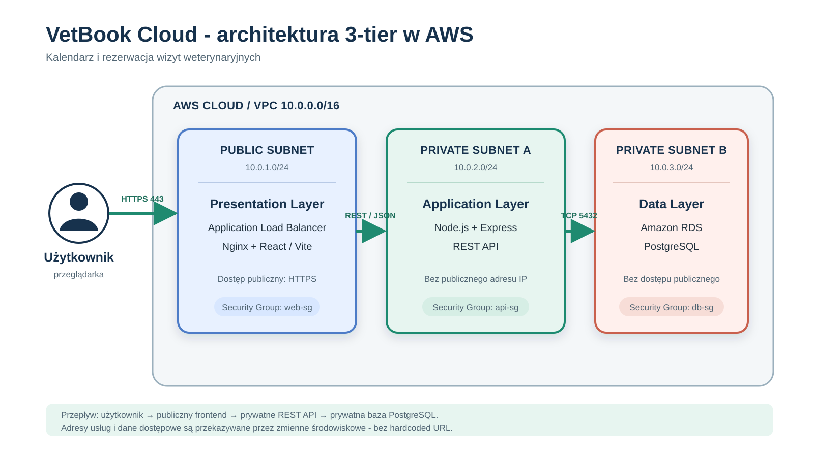

# VetBook Cloud

VetBook Cloud to chmurowy system kalendarza i rezerwacji wizyt weterynaryjnych. Właściciel zwierzęcia może utworzyć konto, dodać profil zwierzęcia, sprawdzić dostępne terminy oraz zarezerwować, przełożyć lub anulować wizytę. Pracownik kliniki zarządza grafikiem, rodzajami usług i statusem wizyt.

## Planowany zakres

- rejestracja i logowanie użytkowników,
- profile zwierząt,
- kalendarz dostępnych terminów,
- rezerwowanie, przekładanie i anulowanie wizyt,
- lista i szczegóły wizyt,
- panel pracownika kliniki,
- walidacja danych po stronie frontendu i backendu,
- role użytkowników: klient i pracownik kliniki.

## Stos technologiczny

- Frontend: React + Vite,
- Backend: Node.js + Express,
- Baza danych: PostgreSQL,
- Chmura: Microsoft Azure,
- Komunikacja: REST API.

## Architektura

Projekt jest planowany jako aplikacja trójwarstwowa:

1. warstwa dostępowa - React oraz publiczny Application Load Balancer,
2. warstwa logiki - prywatny serwer Node.js/Express,
3. warstwa danych - prywatna baza Amazon RDS PostgreSQL.

Szczegółowy opis znajduje się w pliku [`docs/architecture.md`](docs/architecture.md).

## Status

Projekt w fazie planowania i przygotowania architektury.
