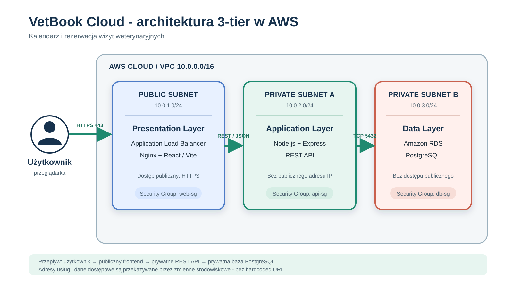

Architektura VetBook Cloud w Microsoft Azure

## Sieć

- Grupa zasobów: `rg-vetbook-cloud`
- Sieć wirtualna: `vnet-vetbook`
- Zakres adresów VNet: `10.0.0.0/16`
- Region zasobów sieciowych: `Norway East`

## Warstwy

### Warstwa prezentacji

- Podsieć: `snet-web`
- Zakres: `10.0.1.0/24`
- Technologia: React + Vite
- Zabezpieczenie: `nsg-web`
- Dozwolony ruch: HTTPS na porcie 443 z Internetu

### Warstwa aplikacji

- Podsieć: `snet-app`
- Zakres: `10.0.2.0/24`
- Technologia: Node.js + Express, REST API
- Zabezpieczenie: `nsg-app`
- Dozwolony ruch: TCP 3000 wyłącznie z `10.0.1.0/24`
- Brak publicznego adresu IP

### Warstwa danych

- Podsieć: `snet-db`
- Zakres: `10.0.3.0/24`
- Technologia: PostgreSQL
- Zabezpieczenie: `nsg-db`
- Dozwolony ruch: TCP 5432 wyłącznie z `10.0.2.0/24`
- Brak dostępu publicznego

## Przepływ ruchu

`Użytkownik -> HTTPS 443 -> snet-web -> TCP 3000 -> snet-app -> TCP 5432 -> snet-db`

## Routing i bezpieczeństwo

- Każda warstwa posiada osobną podsieć i osobną Network Security Group.
- Reguły o priorytecie 100 zezwalają wyłącznie na wymagany ruch między warstwami.
- Reguły o priorytecie 200 blokują pozostały ruch wewnątrz VNet do warstw prywatnych.
- Tabela `rt-private-no-internet` zawiera trasę `0.0.0.0/0` z typem następnego przeskoku `None`.
- Tabela tras jest skojarzona z `snet-app` i `snet-db`.
- Dostęp administracyjny jest kontrolowany przez Microsoft Entra ID, Azure RBAC i MFA.
- Dane konfiguracyjne aplikacji są przekazywane przez zmienne środowiskowe.

## Infrastructure as Code

Odpowiednik konfiguracji infrastruktury został zapisany w katalogu `terraform` w repozytorium projektu.
